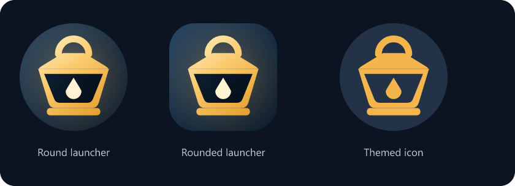
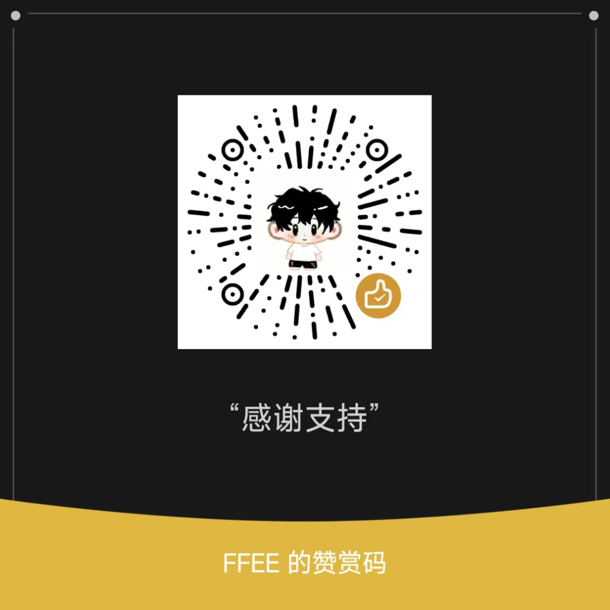

<p align="center">
  
</p>

<h1 align="center">Lamp Guide · Android</h1>
<p align="center"><strong>让手机上的 AI 客户端接入本机网关。</strong></p>
<p align="center">Kotlin · Jetpack Compose · 同进程 Go 网关</p>
<p align="center">
  <a href="https://github.com/LAGcomcom/Lamp-Guide-Android/releases">下载安卓 APK</a> ·
  <a href="https://github.com/LAGcomcom/Lamp-Guide">Windows 桌面版</a> ·
  <a href="docs/BUILD.md">源码构建</a> ·
  <a href="https://github.com/LAGcomcom/Lamp-Guide-Android/issues">反馈问题</a>
</p>

这是 [Lamp Guide](https://github.com/LAGcomcom/Lamp-Guide) 的独立安卓版本，沿用其 Go 网关，并使用原生 Compose 界面。手机内的其他 AI 客户端通过本机地址和专属 Key 访问模型；网关随应用在同一进程中运行，无需另开一台电脑。

## 手机上可以做什么

- 查看网关状态、今日 token 与请求数。
- 添加渠道账号、打开登录页或粘贴 Key，查看额度与签到结果。
- 将 Base URL 和专属 Key 交给 DSH Go 等兼容客户端。
- 搜索、筛选和探测模型，区分同名模型的不同来源。
- 查看用量、调整设置、通过系统文件选择器导入和导出配置。
- 使用跟随系统的深浅主题和悬浮导航。

主界面位于 `android/app-native/`，采用原生控件。`android/app/` 保留早期 WebView 实现作为参考；两者包名不同。

## 安装使用

1. 在 [Releases](https://github.com/LAGcomcom/Lamp-Guide-Android/releases) 下载 APK。当前提供 Android 8.0+、arm64-v8a 版本。
2. 安装并打开 Lamp Guide，在渠道页添加自己的账号或 Key。
3. 在接入页复制本机 Base URL 和专属 Key，填入兼容客户端。
4. 按需允许通知和后台运行，以便前台服务维持网关。

默认客户端入口是 `http://127.0.0.1:8787/v1`，以应用显示的实际地址为准。模型目录、额度和可用性由渠道实际返回；列出模型不代表账号有调用权限。

首个公开预览包沿用开发签名。请保留自己的配置备份；后续若更换签名，旧包不能直接覆盖升级。仓库与 APK 不附带个人账号或访问 Key。

## 项目结构

| 目录 | 内容 |
| --- | --- |
| `android/app-native/` | 当前 Compose 客户端，包名 `com.lampguide.lampnative` |
| `gateway/mobile/` | gomobile 绑定面，向 Kotlin 提供生命周期与管理请求接口 |
| `gateway/internal/zen/` | 渠道、账号、模型、聚合、路由和配置存储 |
| `gateway/internal/host/`、`gateway/internal/zenbridge/` | 管理信封与进程内路由桥 |
| `android/app/`、`gateway/web/` | 早期 WebView 客户端与预览资源 |
| `brand/` | SVG 母版、图标资源生成脚本和预览 |
| `scripts/` | 从源码生成 AAR、构建 APK 的 PowerShell 入口 |

## 从源码构建

准备 JDK 21、Go 1.26、Android SDK 36 / build-tools 36.0.0，以及 NDK 27.2。设置 `JAVA_HOME`、`ANDROID_HOME` 与 `ANDROID_NDK_HOME`，然后在 PowerShell 运行：

```powershell
git clone https://github.com/LAGcomcom/Lamp-Guide-Android.git
cd Lamp-Guide-Android
./scripts/build-android.ps1 -BuildType Release
```

脚本使用 `go.mod` 固定的 gomobile 版本生成 arm64 AAR，再通过 Gradle Wrapper 8.14.3 构建原生客户端。APK 输出到 `dist/`；生成的 AAR、缓存与本地配置不纳入 Git。

更多构建、测试和签名说明见 [docs/BUILD.md](docs/BUILD.md)，架构及平台限制见 [docs/ARCHITECTURE.md](docs/ARCHITECTURE.md)。

## 图标

深蓝夜色与琥珀色提灯，提供彩色、自适应和系统主题单色版本。



SVG 母版为 [`brand/lamp-guide-icon.svg`](brand/lamp-guide-icon.svg)。修改几何与配色后运行 `npm ci`、`npm run icons` 重新生成 Android 资源。

## 支持项目

如果 Lamp Guide 对你有帮助，欢迎自愿赞赏，支持后续开发与维护。

使用微信扫描下方赞赏码，感谢支持。

<p align="center">
  
</p>

## 来源与许可

本项目从 [LAGcomcom/Lamp-Guide](https://github.com/LAGcomcom/Lamp-Guide) 的安卓移植工程独立整理，保留网关来源与版权声明。Windows 桌面版继续在原仓库维护，本仓库维护安卓客户端。

项目许可见 [LICENSE](LICENSE)，组件来源见 [THIRD_PARTY.md](THIRD_PARTY.md)。第三方服务名称、账号权限和使用规则归对应服务所有。
